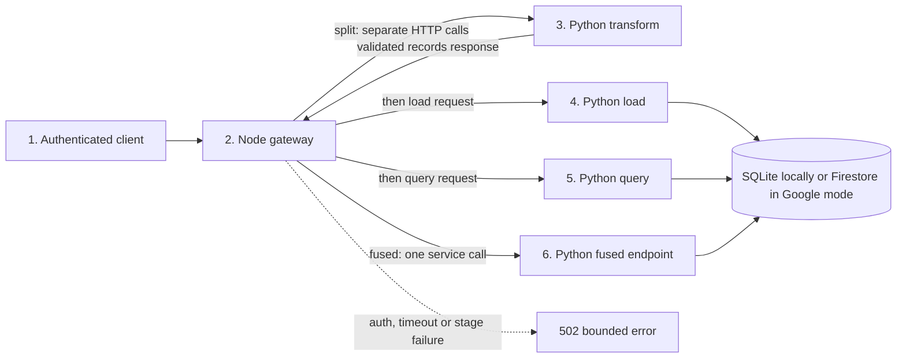
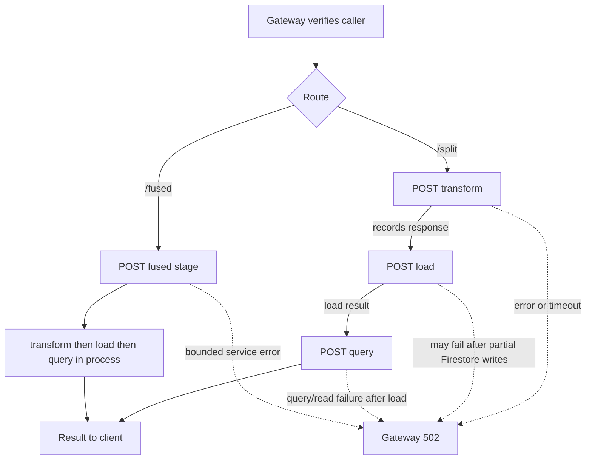
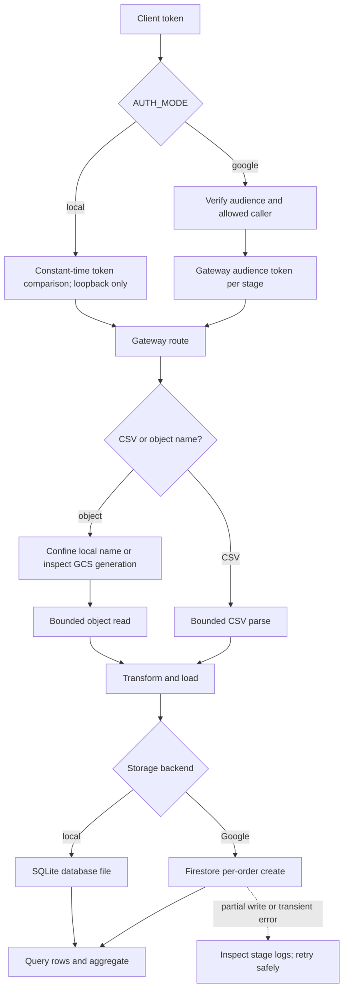
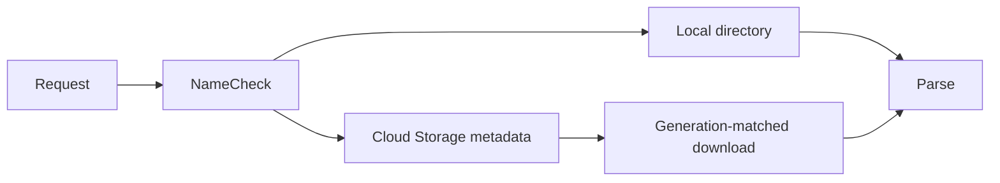
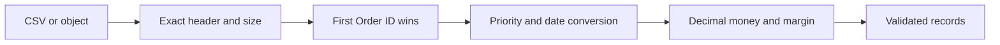
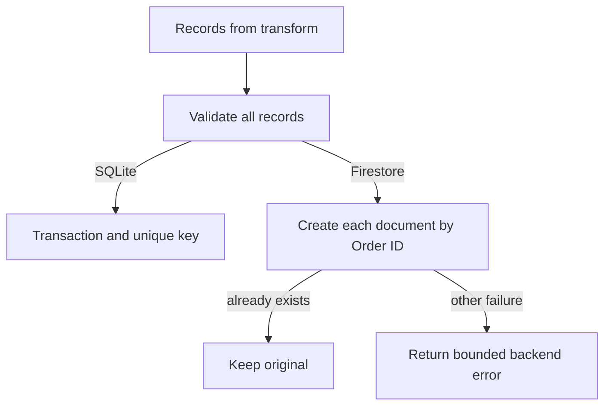
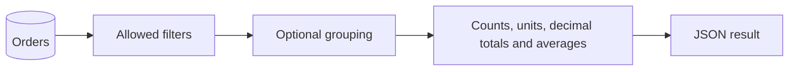
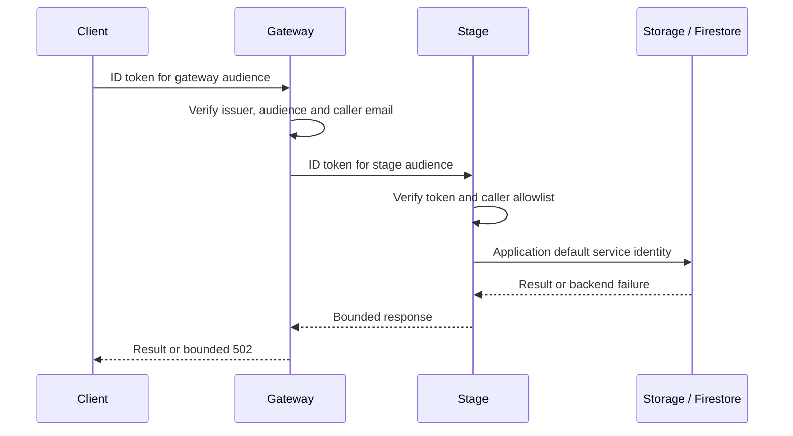
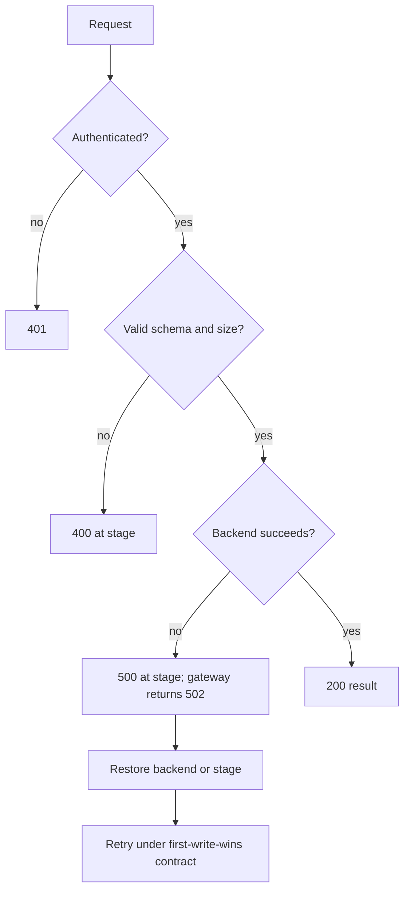

# Sales transform–load–query pipeline

An independent adaptation of the [UW Tacoma TCSS 462/562 Fall 2024 term project](https://faculty.washington.edu/wlloyd/courses/tcss562_f2024/assignments/TCSS462_562_f2024_Term_Project.pdf), pages 7–10. This is not a claim of enrollment, submission, or cloud deployment. The assignment describes a CSV transform, unique-order load, and filtered aggregation; this implementation explores split versus fused service composition using Python and Node.js.

## Main flow



1. **Extract and transform:** submit CSV directly or a configured object name. [Object reads](#object-reads) and [transformation](#transformation) explain the boundaries.
2. **Load:** the gateway forwards transformed records; the load service validates them again and creates unique orders. See [idempotence](#idempotence).
3. **Query:** optional filters and grouping produce aggregates. See [queries](#queries).
4. **Compare:** fused mode calls the same core directly, removing two internal HTTP hops. See [measurement](#measurement).

## Local setup and usage

Requires Python 3.11+ and Node 22+. No cloud account is needed. From this directory:

```sh
python -m venv .venv
# Windows: .venv\Scripts\python; Unix: .venv/bin/python
.venv/Scripts/python -m pip install -r requirements.lock
npm ci
.venv/Scripts/python -m unittest discover -s tests
python scripts/verify.py
```

The driver launches transform, load, query, fused, and gateway processes on loopback ports with isolated SQLite storage. It checks readiness, split/fused output, grouped results, authorization, process restart, backend failure and recovery, and database rows; then runs the benchmark and cleans up its own processes and scratch files. Results survive in `evidence/verification.json` and `evidence/campaign.json`; the previous smoke receipt is `evidence/benchmark.json`. See the maintained [verification skill](.agents/skills/verify-serverless-data-pipeline/SKILL.md) and [feature map](.agents/skills/verify-serverless-data-pipeline/features/README.md). SDK contract tests use fakes at the SDK boundary and do not establish cloud behavior.

For an already running local gateway, POST `/split` or `/fused` with `Authorization: Bearer <SERVICE_TOKEN>` and JSON such as `{"csv":"<CSV contents>","filters":{"country":"France"},"group_by":["priority"]}`. Alternatively replace `csv` with `object`, a relative name inside `OBJECT_DIR`. `filters` and `group_by` accept `region`, `country`, `item_type`, `channel`, and `priority`; omit grouping for one aggregate object. Grouped results are sorted arrays. Aggregates include count, units sum/min/max/average, revenue and profit sums, average processing days and average margin. Empty average values are null.

To start services manually on Windows, open five project-root PowerShell terminals. In each terminal set the following common environment first; use a private scratch directory and a fresh token:

```powershell
$env:AUTH_MODE='local'; $env:SERVICE_TOKEN='choose-a-local-token'
$env:BACKEND='local'; $env:SQLITE_PATH='C:\temp\sales-orders.db'; $env:OBJECT_DIR='C:\temp'
```

In four terminals set `STAGE` and `PORT` to respectively `transform`/8101, `load`/8102, `query`/8103, and `fused`/8104, then run `python service.py`. In the fifth:

```powershell
$env:TRANSFORM_URL='http://127.0.0.1:8101'; $env:LOAD_URL='http://127.0.0.1:8102'
$env:QUERY_URL='http://127.0.0.1:8103'; $env:FUSED_URL='http://127.0.0.1:8104'
$env:PORT='8100'; node gateway.mjs
```

The database file is persistent in this manual example. Stop each process with Ctrl+C and remove only scratch data you own when finished. The automated driver is preferable for isolated repeatable checks.

## Subsystems and techniques

### Resume review map

The two compositions are distinct request paths. `/split` makes three sequential stage calls from the gateway (transform, load, query); `/fused` calls only the fused Python endpoint, whose service invokes the same core functions directly. They are not background-linked processes. Split mode persists before querying, so a failure after load may leave rows committed. Local SQLite is a single configured file; Google mode stores orders in Firestore and reads the collection for aggregation.

| Step | Handoff and technique | Exact implementation |
| --- | --- | --- |
| <a id="flow-step-client"></a>1. Client request | Bearer auth and JSON filters/grouping | [gateway request handler](gateway.mjs#L31) |
| <a id="flow-step-gateway"></a>2. Gateway boundary | Verifies local token or Google caller token; enforces request bound | [gateway authorization and routing](gateway.mjs#L31) |
| <a id="flow-step-transform"></a>3. Transform | Parse CSV/object, validate and derive normalized records | [transform](pipeline.py#L21), [object read](pipeline.py#L122), [transform route](service.py#L10) |
| <a id="flow-step-load"></a>4. Load | Revalidate rows; insert unique Order IDs, preserving existing first write | [load](pipeline.py#L56), [validation](pipeline.py#L76), [service dispatch](service.py#L10) |
| <a id="flow-step-query"></a>5. Query | Apply allowed filters, group and compute decimal aggregates | [query](pipeline.py#L97), [service dispatch](service.py#L10) |
| <a id="flow-step-fused"></a>6. Fused | One HTTP request invokes transform, load, query inside one service | [fused stage route](service.py#L10), [core functions](pipeline.py#L21) |

### Split and fused execution details



### Authentication, object and storage subsystem



<details><summary>Technique: gateway to independently authenticated stages</summary>

**How:** the gateway checks the caller, then `call()` sets the stage audience and obtains an ID token in Google mode. Each Python service independently verifies its own audience/caller boundary. Local mode uses a constant-time shared-token comparison and loopback URLs.

**Why:** private stages can enforce their own caller access even when called outside the gateway.

**Alternative and tradeoff:** a single public service is simpler, but combines deployment and scaling. Google auth and IAM contract tests use fakes; no live cloud configuration or calls were verified.
</details>

<details><summary>Technique: first-write-wins load and bounded retry</summary>

**How:** the load endpoint validates the complete request before writing. SQLite uses a unique key and transaction; Firestore calls `create` per Order ID and treats already-exists as a duplicate.

**Why:** retrying after an ambiguous error does not duplicate existing orders.

**Alternative and tradeoff:** a transactional manifest could make an entire dataset visible atomically. Firestore writes are separate, so partial progress can remain when a later write fails; existing payload wins even if a retry contains changed data.
</details>

<details><summary>Technique: recover from stage or backend failures</summary>

**How:** gateway errors are logged without exposing internals and returned as bounded 502; malformed direct stage input returns 400. Stage calls time out after 15 seconds. Readiness endpoints do not check backend health.

**Why:** callers get a stable boundary while operators inspect detailed local service logs and recover the dependency.

**Alternative and tradeoff:** automatic retries could repeat writes and obscure partial progress; the current gateway does not retry. Safe replay depends on the first-write-wins key contract, and does not make a split workflow atomic.
</details>

<details><summary>Technique: fused local functions</summary>

**How:** fused service selects one incoming HTTP route, then calls transform, load and query core functions in process. Split mode sends three sequential stage HTTP requests.

**Why:** this makes network-hop composition comparable using shared domain logic.

**Alternative and tradeoff:** fused mode couples the operations into one deployed service. The local duplicate-write benchmark cannot establish fresh-insert performance or cloud throughput.
</details>

<a id="technique-auth"></a><a id="technique-fused"></a><a id="technique-recovery"></a><a id="technique-local-storage"></a><a id="technique-object-reads"></a>

### Object reads



Local reads resolve names under `OBJECT_DIR`; cloud reads use the official [Cloud Storage Python client](https://cloud.google.com/python/docs/reference/storage/latest/google.cloud.storage.blob.Blob), reload metadata, enforce a size bound, then condition the download on its observed generation. This avoids silently reading a replacement object after checking the old size. An object precondition failure is a backend error and should be retried by the caller after deciding whether to accept the new object. Cloud mode requires `BACKEND=firestore`, `GCS_BUCKET`, application default credentials, and appropriate IAM. This path is contract-tested, not live-tested.

<a id="technique-transform"></a>
### Transformation



The exact fourteen-column course header is required, with at most 2 MB and 1,000 input rows. Dates use month/day/year, priority codes map L/M/H/C to Low/Medium/High/Critical, and the first occurrence of each decimal Order ID wins. Processing days are ship date minus order date; negative durations fail. Python `Decimal` stores revenue and profit as decimal strings and calculates profit/revenue; zero revenue yields null margin and is excluded from its average. Load revalidates money, integer types, labels, and calculated margin. Decimal division uses Python's current decimal context; non-terminating ratios are rounded to that precision. The small bounded in-memory design makes validation and repeatable local experiments simple, but cannot process the course's 179 MB example without chunking or streaming.

<a id="technique-idempotence"></a>
### Idempotence



SQLite uses a primary key and `INSERT OR IGNORE` in one transaction. Firestore uses per-document `create` keyed by order ID, treating the official client's [already-exists conflict](https://cloud.google.com/python/docs/reference/firestore/latest/google.cloud.firestore_v1.document.DocumentReference) as a duplicate. Existing rows win, even when a later payload differs. Firestore writes are individually atomic, not a batch transaction: on partial failure, retrying is safe under this first-write-wins rule but a concurrent query can observe a partial load. `accepted` means validated input rows attempted, not newly inserted rows. A manifest or transactional batch design would be needed for dataset-level atomic visibility.

<a id="technique-query"></a>
### Queries



The service reads stored rows, applies an allowlist of filters, groups in memory, and calculates Decimal sums. This keeps local and Firestore outputs equivalent and avoids interpolating user-supplied SQL identifiers. The tradeoff is a full Firestore collection scan and unbounded query memory/cost as the collection grows. Production scale requires indexed server-side queries or an analytical store and pagination. A shared Firestore collection must contain only this schema. SQLite is a local stand-in, not shared persistent storage across Cloud Run instances.

### Service authentication and configuration



`AUTH_MODE=local` requires `SERVICE_TOKEN` and binds to loopback; the gateway accepts only loopback stage URLs. Use it solely for isolated local development. `AUTH_MODE=google` binds to `0.0.0.0:$PORT`, requires `AUDIENCE` and comma-separated `ALLOWED_CALLERS`, and verifies Google ID token audience and email with official auth libraries. The gateway obtains an audience-bound ID token per stage using [`getIdTokenClient`](https://cloud.google.com/docs/authentication/get-id-token). Set `TRANSFORM_URL`, `LOAD_URL`, `QUERY_URL`, and `FUSED_URL` to the corresponding service base URLs. Each Python service requires `STAGE=transform|load|query|fused`; gateway and each stage need their own audience and allowed caller configuration. Use private Cloud Run services with narrowly scoped invoker and data roles as described in [service-to-service authentication](https://cloud.google.com/run/docs/authenticating/service-to-service). No credentials, IAM, resources, containers, or live calls were configured or tested here. The [Cloud Run container contract](https://cloud.google.com/run/docs/container-contract) requires listening on the provided port.

### Error and recovery flow



The gateway returns a bounded 502 for stage failures and does not expose underlying details. A malformed or oversized direct stage request gets 400. Inspect service logs and configuration, correct input or access, and retry under the idempotence rule; do not assume a failed Firestore load wrote nothing. Gateway requests have a 15-second stage timeout. Health checks only indicate process readiness, not database or IAM health.

### Measurement

`scripts/bench.mjs` runs Autocannon with 50 completed requests per run, alternating five split/fused pairs at each concurrency of 1 and 8. Every request uses the same preloaded CSV of 1,000 distinct orders, so timed writes are idempotent duplicate attempts, not fresh inserts. Each response is checked; after each run an independent grouped aggregate and direct SQLite count provide output and committed-row oracles. The receipt includes every run, status/error counts, latency in milliseconds, platform, CPU, software versions, dataset hash, and source hash. These measurements include the local generator, gateway, Python services, and SQLite on one machine; they do not establish which component limits throughput and do not predict cloud latency, cold-start, or cost. The earlier failed campaigns and diagnostic receipts are retained in `evidence/`. During diagnosis the transform service refused some concurrent connections; its inherited listen backlog was five. A separate socket saturation probe and an otherwise unchanged focused run after using the platform's maximum listen queue support queue saturation as the cause, though the probe's failures were timeouts rather than connection refusals. No retries or longer timeouts were added.

Autocannon 8.0.0 is the latest published version found during review. Its development-only `hyperid` dependency uses `uuid` affected by [GHSA-w5hq-g745-h8pq](https://github.com/advisories/GHSA-w5hq-g745-h8pq); npm audit reports three moderate findings in the dev dependency chain and no production findings. The available suggested remediation changes to an older major Autocannon version, so it was not forced.

In the final local campaign, all 20 runs completed 50 requests with zero HTTP errors and matched the per-response and grouped oracles; each post-run database count was 1,002 including two earlier sample orders. Mean latency ranges were 29.56–32.64 ms split and 21.66–23.76 ms fused at concurrency 1; 110.26–218.94 ms split and 140.62–326.84 ms fused at concurrency 8. A brief unit and static-check run overlapped this campaign, so background work may have affected its timings. The historical source snapshot hash was `aa815f91922f65e484b614d0973955eb10b244f076eeff428e3c28f2ca39ee1b`; the generated dataset hash was `0e6019413b5d719964a8cc725a33aabe49362b0e341701da298931f18d3626ce`. A later non-string CSV validation fix changed the source; the campaign was not rerun. No speedup is inferred from these small, variable local runs.

## Interview walkthrough and glossary

The transformed output is a reduced analytical schema. It retains order identity, dimensions, derived shipping days, units, revenue, profit and margin. Original order/ship dates, unit price/cost and total cost are not stored in this schema; preserve the source object when those fields are needed for audits or different reports.

An interviewer can trace one sample order from the CSV through decimal transformation, the authenticated gateway, unique-key load, and filtered grouped query. Then compare the two compositions: split makes independent stage deployment possible but adds network boundaries; fused removes those boundaries while coupling scaling and deployment. A *generation* identifies an object version, an *audience* identifies the intended token recipient, *idempotence* makes retries preserve the same stored state, and an *oracle* is the expected output and side effect used to judge a run. The course's alternative architecture and repeated-input comparison motivate this exercise; the local results do not fulfill its cloud performance or cost experiment.

## Scoped resume evidence

- Built a Python/Node sales pipeline with separately runnable HTTP transform, load, and query stages and repeat-safe order-key writes; verified split and fused local responses and two committed sample orders.
- Measured five interleaved local Autocannon runs per composition at each of two concurrency levels with 1,000-order requests; all 1,000 responses and per-run database counts matched their oracles on the documented warm loopback workload.
